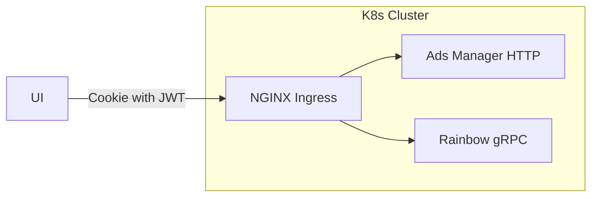
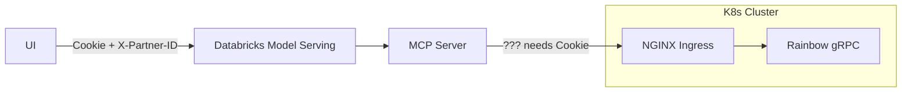
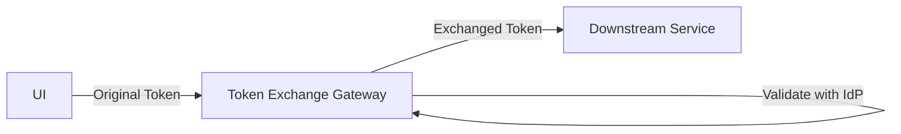
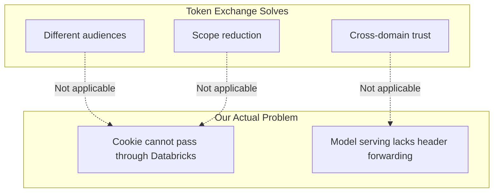
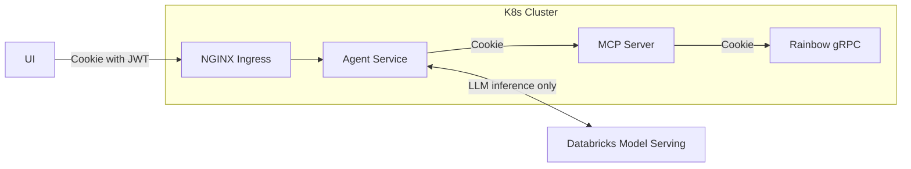
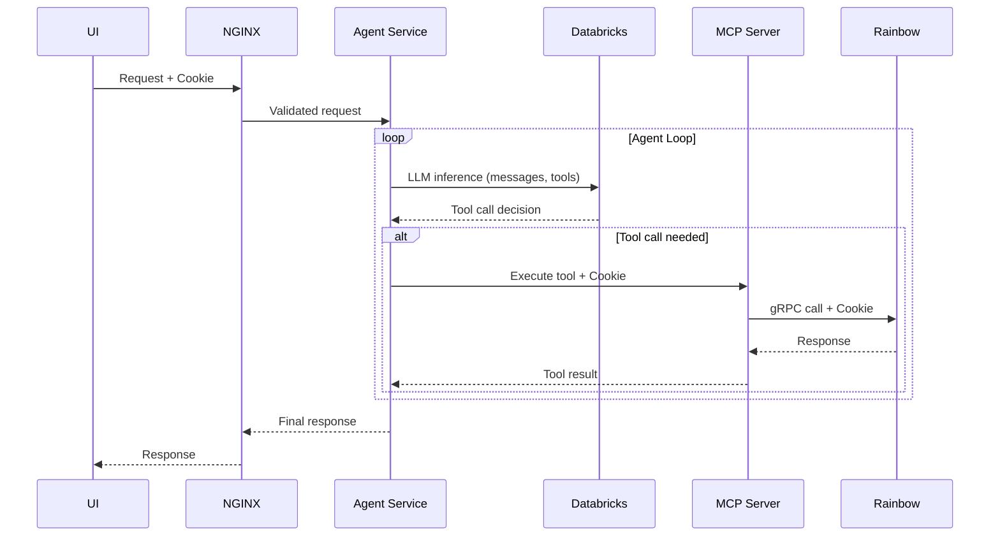

# Agent Architecture: Authentication Considerations

## Overview

This document explores authentication approaches for an agentic AI system that needs to interact with backend gRPC services (Rainbow) protected by Cookie-based Okta authentication.

## Current Architecture



**Key characteristics:**
- UI authenticates via Okta, receiving a Cookie containing a JWT with user roles
- NGINX serves as ingress for the K8s cluster
- Both Ads Manager (HTTP) and Rainbow (gRPC via web-grpc) expect the Cookie for authentication
- All services share the same authentication mechanism

---

## Proposed Agentic Flow: Databricks Model Serving

Initial proposal: Deploy DSPy models to Databricks Model Serving, exposed via OpenAI-compatible `llm/v1/chat` API.



### The Problem

Databricks Model Serving uses the OpenAI Chat Completion API specification (`ChatCompletionRequest`), which only captures the **request body**—not HTTP headers.

```python
class ChatCompletionRequest(BaseRequestPayload):
    messages: list[ChatMessage]
    tools: list[ChatTool] | None
    # No field for headers, cookies, or auth context
```

**Challenges:**
1. Cookie (containing Okta JWT) cannot be passed via standard chat completion API
2. Even if JWT is passed in request body, Databricks would need to forward it to MCP Server
3. MCP Server would need to reconstruct the Cookie header for NGINX

---

## Why Token Exchange Does Not Apply

Token exchange (OAuth 2.0 RFC 8693) is typically used when:
- Tokens need audience (`aud`) claim changes
- Credentials need scope reduction for downstream services
- Different trust domains require different token issuers



### Why It Doesn't Solve Our Problem

In our architecture:

1. **Same trust domain**: NGINX already validates the Cookie JWT for all backend services (Ads Manager, Rainbow). No audience or issuer change is needed.

2. **Cookie is the transport**: NGINX expects authentication via Cookie header, not a Bearer token in Authorization header. Token exchange produces tokens, not cookies.

3. **The real problem is transport, not trust**: The JWT in the Cookie is already valid for Rainbow. The issue is that Databricks Model Serving cannot pass HTTP cookies through its inference pipeline.



**Conclusion**: Token exchange addresses trust/scope problems. Our problem is that Databricks Model Serving is not designed to act as an authenticated proxy to Cookie-based backend services.

---

## Recommended Approach: Agent Service in K8s

Keep the agent orchestration within the K8s cluster, behind NGINX, where Cookie-based authentication works naturally.



### How It Works

1. **UI** sends request to Agent Service via NGINX with Cookie (same as existing flows)
2. **NGINX** validates Cookie, forwards request to Agent Service
3. **Agent Service** orchestrates the agent loop:
   - Calls Databricks for LLM reasoning (no auth needed, just inference)
   - Receives tool call decisions from LLM
   - Executes tools via MCP Server, **passing the Cookie**
   - Returns tool results to LLM for next reasoning step
4. **MCP Server** proxies requests to Rainbow with Cookie intact
5. **Rainbow** receives authenticated requests, returns data

### Benefits

| Aspect | Benefit |
|--------|---------|
| **Authentication** | Cookie stays within K8s trust boundary; no credential passthrough via Databricks |
| **Simplicity** | Uses existing NGINX auth for all services including new agent components |
| **Security** | User JWTs never enter third-party ML infrastructure |
| **Flexibility** | Databricks handles LLM inference; agent logic is under your control |

### Agent Loop: Orchestration Detail



---

## Summary

| Approach | Viable? | Reason |
|----------|---------|--------|
| Databricks as agent runtime | No | Cannot forward Cookie to MCP/Rainbow |
| Token exchange | No | Problem is transport (Cookie header), not trust/scope |
| Agent Service in K8s | Yes | Cookie flows naturally through NGINX to MCP to Rainbow |

The recommended architecture separates concerns:
- **Databricks**: LLM inference (stateless, no auth context needed)
- **Agent Service**: Orchestration, tool execution, auth context management
- **MCP Server**: Proxy to Rainbow with Cookie-based auth
